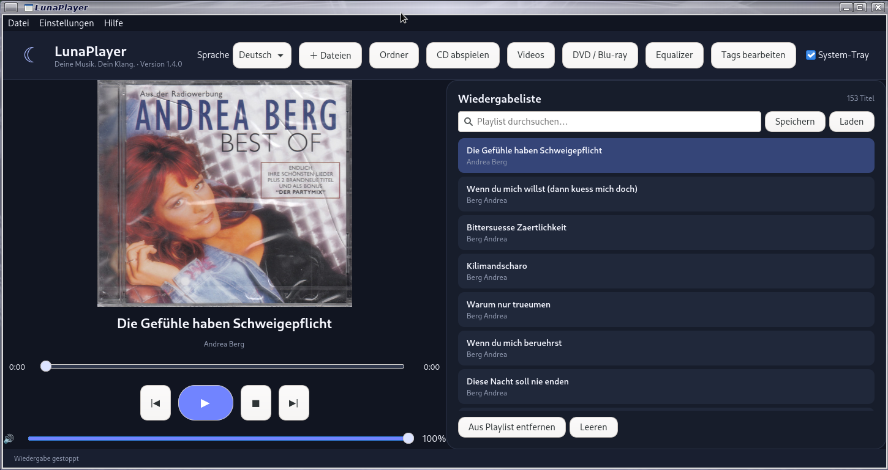
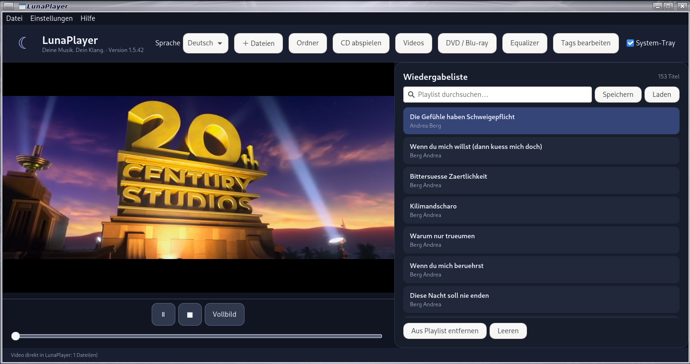

# LunaPlayer 1.6.5

**Ein Musikplayer und Videoplayer für Linux · Goldisoft 2026**

LunaPlayer ist ein Desktop-Musikplayer und Video-Player für Linux und Raspberry. Dieses Repository enthält den Quellcode, die benötigten Projektdateien und Skripte zum Erstellen des Debian-Pakets.





[Github Seite](https://github.com/Angonikro/LunaPlayer/)

## Funktionen

- Unterstützte Audioformate: **MP3 (`.mp3`), WAV (`.wav`), Ogg Vorbis (`.ogg`, `.oga`), M4A (`.m4a`) und MP4-Audiodateien (`.mp4`, ohne Videoausgabe)**
- M4A- und MP4-Audiodateien auswählen, in Musikordnern finden und in Wiedergabelisten aufnehmen
- Die Wiedergabe hängt vom enthaltenen Audio-Codec und den installierten GStreamer-Plugins ab; nicht jede Datei mit diesen Endungen ist automatisch abspielbar
- Musikdateien und Musikordner öffnen und abspielen
- Wiedergabelisten verwalten und speichern
- Musiktitel suchen und filtern
- Titelinformationen (Tags) anzeigen und – soweit vom Dateiformat unterstützt – bearbeiten
- Equalizer und Klangprofile verwenden
- Audio-CD-Wiedergabe und CD-Informationen abrufen, sofern Laufwerk, Werkzeuge und Online-Dienste verfügbar sind
- Audiogerät und Erscheinungsbild konfigurieren
- System-Tray verwenden, sofern die Desktop-Umgebung Statussymbole unterstützt
- Sprachwahl Deutsch/Englisch über **Einstellungen → Sprache / Language**; zusätzlich ist die Auswahl in der Kopfzeile verfügbar

## TV / IPTV (M3U)
LunaPlayer kann M3U- und M3U8-TV-Playlists laden. Wähle **Datei → TV-Playlist öffnen…**. Die Sender erscheinen in der Wiedergabeliste und werden mit dem integrierten VLC-Player mit Bild und Ton wiedergegeben.

## Video, DVD und Blu-ray

- Videodateien wie MKV, MP4, AVI, MOV, M4V, WebM, MPEG/MPG, TS/M2TS, WMV, FLV, OGV und 3GP in einem von LunaPlayer verwalteten Videofenster öffnen; mehrere ausgewählte Dateien werden nacheinander abgespielt.
- DVD und Blu-ray über **DVD / Blu-ray** starten. Das optische Laufwerk kann im Dialog angegeben werden (Standard: `/dev/sr0`).
- LunaPlayer bleibt der Name und das bestehende Musikprogramm bleibt erhalten. Wegen eines GTK4/X11-Kompositionsproblems wird die Videowiedergabe nicht mehr als überlagerte Fläche im Musikfenster gezeichnet: LunaPlayer öffnet dafür ein eigenes, von der App verwaltetes Videofenster und übergibt dessen native X11-Fläche an libVLC. Während Video läuft, werden die MP3-Titelanzeige, Audio-Zeitleiste, Musiktransport- und Lautstärkeregler ausgeblendet. Vollbild bezieht sich nur auf das Videofenster; Esc beendet Vollbild und im Fenstermodus schließt Esc das Videofenster.
- Blu-ray-Menüs und geschützte Discs werden nicht garantiert unterstützt; dies hängt von VLC, `libbluray`, dem Laufwerk und dem Disc-Schutz ab.

## Sprache einstellen

Öffnen Sie **Einstellungen → Sprache / Language** und wählen Sie **Deutsch** oder **English**. Die Auswahl wird in `~/.config/lunaplayer/settings.json` gespeichert. Starten Sie LunaPlayer danach neu, damit alle Texte aktualisiert werden. Einige Meldungen externer Bibliotheken oder Systemdienste können weiterhin in einer anderen Sprache erscheinen.

## System-Tray

Das Tray-Verhalten hängt von der Desktop-Umgebung und deren Unterstützung für Statussymbole ab. Wenn das Symbol nicht erscheint, prüfen Sie die Tray-/Panel-Unterstützung Ihrer Desktop-Umgebung. Für eine zuverlässige Fehlerdiagnose kann ein Start aus dem Terminal hilfreich sein.

## Audio-CDs und Online-Metadaten

CD-Erkennung und Online-Metadaten hängen unter anderem vom optischen Laufwerk, den installierten Systemwerkzeugen, der Netzwerkverbindung und der Verfügbarkeit externer Dienste ab. Deshalb können Online-Ergebnisse nicht garantiert werden.

## Voraussetzungen

- Linux mit einer unterstützten Desktop-Umgebung
- Python 3 und die im Projekt bzw. im Debian-Paket angegebenen Abhängigkeiten
- Für eingebettete Video-Wiedergabe: `python3-vlc`, `libvlc5` und `vlc-plugin-base`; diese Pakete werden durch das DEB automatisch als Abhängigkeiten installiert. Das Paket `vlc` bleibt zusätzlich für die vollständige VLC-Plugin-Ausstattung enthalten.
- Für DVD-/Blu-ray-Unterstützung: optional `libdvdnav4`, `libdvdread8` und `libbluray2` (im DEB als Empfehlungen aufgeführt)
- Für Audio-CD-Funktionen: ein erkanntes CD-Laufwerk sowie die dafür benötigten Systemwerkzeuge
- Für Online-Abfragen: eine funktionierende Internetverbindung

Die konkret benötigten Pakete können je nach Distribution und installierter Version variieren. Für die Einbettung verwendet LunaPlayer libVLC über `python3-vlc`; die nativen Bibliotheken und VLC-Plugins werden mitinstalliert. Die Einbettung benötigt derzeit eine X11-Sitzung oder XWayland. Optionale DVD-/Blu-ray-Bibliotheken können bei Bedarf mit `sudo apt install libdvdnav4 libdvdread8 libbluray2` ergänzt werden.

## Installation auf Debian / Raspberry Pi OS

1. Laden Sie `lunaplayer_1.6.5_all.deb` herunter.
2. Öffnen Sie ein Terminal im Download-Ordner.
3. Installieren Sie das Paket:

   ```bash
   sudo apt install ./lunaplayer_1.6.5_all.deb
   ```

4. Starten Sie LunaPlayer über das Anwendungsmenü. Falls der Startbefehl verfügbar ist, können Sie auch `lunaplayer` im Terminal verwenden.

### Optional: Desktop-Symbol nach der DEB-Installation

Wenn du zusätzlich ein Symbol direkt auf dem Desktop möchtest, führe diese Befehle in einem Terminal aus:

```bash
chmod +x /usr/share/lunaplayer/install_desktop_launcher.sh
/usr/share/lunaplayer/install_desktop_launcher.sh
```

Das Skript erstellt `LunaPlayer.desktop` auf deinem Desktop. **Bei der ZIP-Version verweist das Symbol direkt auf `main.py` in genau diesem entpackten Ordner** und startet nicht die zusätzlich installierte DEB-Version. Wenn du mehrere ZIP-Versionen entpackst, erstellt jede Version beim Ausführen des Skripts einen Starter für ihren eigenen Ordner. Falls deine Desktop-Umgebung beim ersten Start nachfragt, erlaube das Starten bzw. markiere den Starter als vertrauenswürdig.

## Installation aus der GitHub-ZIP (ohne DEB-Paket)

Diese Schritte sind für Debian 13 / Raspberry Pi OS auf einem Desktop-System gedacht. **Nicht** in einer virtuellen Python-Umgebung installieren: LunaPlayer benötigt die GTK- und GStreamer-Bindings des Systems.

1. ZIP im Dateimanager entpacken. Im Terminal in den entpackten Ordner wechseln, der `main.py` enthält. Beispiel, wenn die ZIP im Ordner „Downloads“ liegt:

   ```bash
   cd ~/Downloads
   unzip LunaPlayer_1.6.5_GITHUB.zip
   cd LunaPlayer
   ```

   Falls dein Browser die ZIP an einem anderen Ort gespeichert hat, passe den Pfad entsprechend an.

2. Benötigte Systempakete installieren:

   ```bash
   sudo apt update
   sudo apt install python3 python3-tk python3-gi gir1.2-gtk-4.0 gir1.2-gtk-3.0 python3-gst-1.0 python3-mutagen python3-vlc libvlc5 vlc-plugin-base vlc gstreamer1.0-plugins-base gstreamer1.0-plugins-good gstreamer1.0-plugins-bad gstreamer1.0-plugins-ugly gstreamer1.0-libav libcdio-utils cd-discid eject unzip
   ```

3. LunaPlayer direkt aus dem entpackten Projektordner starten:

   ```bash
   /usr/bin/python3 main.py
   ```

   Lass das Terminal geöffnet, solange du testest. Falls etwas nicht startet, werden Fehlermeldungen dort ausgegeben. LunaPlayer benötigt eine grafische Desktop-Sitzung; ein reines SSH-Terminal ohne grafische Sitzung reicht nicht.

4. Optional: Wenn du lieber über das Anwendungsmenü startest, ist die DEB-Installation der empfohlene Weg. Das Paket richtet den Menüeintrag und das Symbol ein.

### Optional: Desktop-Symbol für die ZIP-Version

Wechsle im Terminal in den entpackten `LunaPlayer`-Ordner (dort, wo `main.py` liegt) und führe aus:

```bash
chmod +x install_desktop_launcher.sh
chmod +x scripts/create_desktop_entry.sh
./install_desktop_launcher.sh
```

Das Skript erstellt `LunaPlayer.desktop` auf deinem Desktop und verweist auf `main.py` im entpackten Ordner. Verschiebe oder lösche den Projektordner danach nicht, sonst stimmt der gespeicherte Startpfad nicht mehr. Falls deine Desktop-Umgebung beim ersten Start nachfragt, erlaube das Starten bzw. markiere den Starter als vertrauenswürdig. Das Skript berücksichtigt nach Möglichkeit den in `~/.config/user-dirs.dirs` definierten Desktop-Ordner (`XDG_DESKTOP_DIR`).

**Wichtig:** Die ZIP-Installation kopiert das Programm nicht automatisch ins System und erstellt keinen Menüeintrag. Zum Entfernen genügt es, LunaPlayer zu schließen und den entpackten Ordner zu löschen. Die Einstellungen bleiben davon getrennt im Benutzerprofil.


## Start aus dem Quellcode

Die genauen Schritte hängen von den Projektabhängigkeiten ab. Prüfen Sie zunächst die Paket- und Abhängigkeitsdefinitionen im Repository. Das Debian-Paket ist der empfohlene Installationsweg für unterstützte Debian-basierte Systeme.

## Projektstruktur

- `README.md` – diese Installations- und Projektübersicht
- `CHANGELOG.md` – Versionshistorie und Änderungen
- `tests/` – automatisierte Tests für die Entwicklung
- `packaging/` – Dateien und Skripte zur Paketierung, sofern im Projekt enthalten

Die tatsächliche Struktur kann je nach Paketstand zusätzliche Dateien und Verzeichnisse enthalten.

## Lizenz

Die Lizenzbedingungen stehen in der Datei `LICENSE`, sofern sie in diesem Repository enthalten ist. Bitte beachten Sie die dort angegebenen Bedingungen.

---

**Goldisoft · 2026**
\n\n### Sprache sofort umstellen\n\nDie Auswahl unter **Einstellungen → Sprache / Language** speichert Deutsch oder English und baut das Fenster direkt neu auf. Ein manueller Neustart sollte dafür nicht nötig sein.\n

73 de DO2QG Andreas
